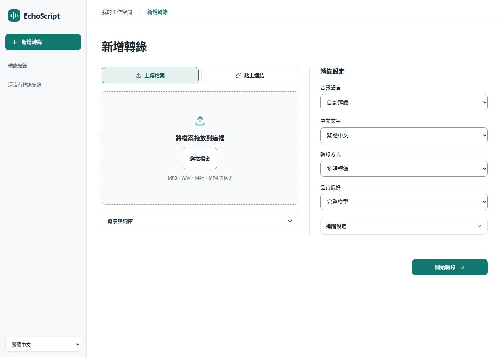

# echoscript

[English](README.md) | **繁體中文**

把錄音和影片變成可編輯的逐字稿與字幕，可選擇本機模型或 OpenAI 轉錄。

- 上傳音訊、影片，或貼上公開 YouTube 連結。
- 支援日文、中文、英文及混合語言，可提供人名與專有名詞提示。
- 回聽原音、修正文字，匯出 TXT、SRT、VTT 或 JSON。

介面可切換英文與繁體中文，適用桌面與手機，並依系統設定切換淺色或深色外觀。



## 安裝

需要 **Linux** 與 [uv](https://docs.astral.sh/uv/getting-started/installation/)。本機模型另需**已安裝驅動的 NVIDIA GPU**。uv 會為專案準備 Python 3.11；網頁介面已附，不需要安裝 Node.js。

先安裝 Git 與 FFmpeg（Ubuntu / Debian）：

```bash
sudo apt update
sudo apt install -y git ffmpeg
```

下載並安裝專案：

```bash
git clone https://github.com/susuky/echoscript.git
cd echoscript
uv sync
```

安裝成功後，建立本機設定檔：

```bash
test -e .env || cp .env.example .env
chmod 600 .env
```

## 啟動

在專案目錄執行：

```bash
uv run --env-file .env --no-sync python serve.py
```

開啟 **[http://127.0.0.1:7860](http://127.0.0.1:7860)**，上傳錄音即可開始轉錄。預設使用 Qwen3-ASR，第一次使用會下載模型，等待時間較長。

按 `Ctrl+C` 停止；之後使用同一條指令啟動即可。

預設允許區域網路連線，沒有登入功能。若只供本機使用，啟動前在 `.env` 將 `ECHOSCRIPT_WEB_HOST` 改為 `127.0.0.1`。

預設允許 IP 位址、`localhost` 與本機主機名稱。若透過反向代理使用自訂網域，啟動前在 `.env` 設定 `ECHOSCRIPT_TRUSTED_HOSTS=transcription.example.com`；多個網域以逗號分隔。

## 使用 OpenAI

在**新增轉錄 → 轉錄設定 → 轉錄方式**選擇 **OpenAI**，輸入 **OpenAI API key** 並按**儲存**，即可使用 `gpt-transcribe`，不需要本機 GPU。音訊會傳送至 OpenAI，費用由該 key 所屬帳戶支付。此方式可匯出 TXT 與 JSON，不提供時間戳、字幕或講者分離。

儲存的 key 供此伺服器的所有使用者共用，存放於 `ECHOSCRIPT_DATA_DIR/openai-api-key`，檔案權限為 `0600`，優先於 `.env` 的 `OPENAI_API_KEY`。應用程式不會將 key 寫入瀏覽器儲存空間，API 也不回傳金鑰內容。

## 命令列用法

完成安裝後，可直接轉錄附帶的範例，不需要啟動網頁服務：

```bash
uv run --env-file .env --no-sync echoscript transcribe This_is_an_example.mp3
```

逐字稿會顯示在終端機。將 `This_is_an_example.mp3` 換成自己的音訊或影片檔案路徑即可。

使用已儲存的 key 或 `.env` 的 `OPENAI_API_KEY` 執行 OpenAI 轉錄：

```bash
uv run --env-file .env --no-sync echoscript transcribe This_is_an_example.mp3 --model gpt-transcribe
```

更多 CLI 選項、其他模型、講者分離、API 與部署方式，請見[使用指南](docs/usage.md)。
